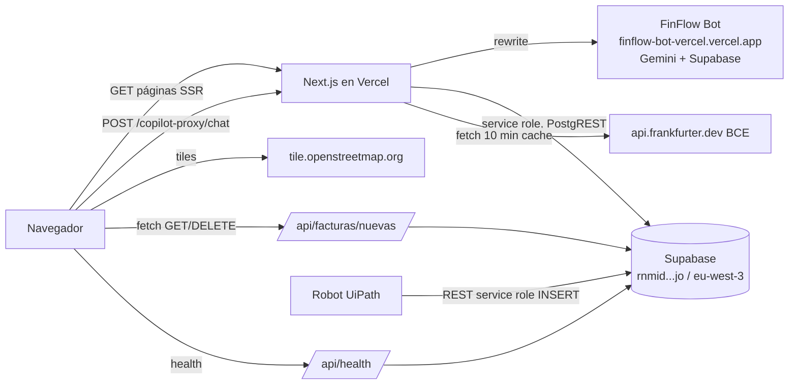

# AUDITORÍA — Dashboard NextWear / FinFlow (Cuentas por Pagar)

Fecha: 2026-10-15 · Alcance: repo `DASHBOARD_NEXTWEAR` (app única, sin monorepo) · Modo: solo lectura (único fichero creado: este).
Verificado en la auditoría: `npx tsc --noEmit` sin errores; `npm run lint` 0 errores y 1 warning (`scripts/generate-facturas-china.mjs:55`). **No** se ha ejecutado `next build`.

---

## 1. Resumen ejecutivo

- App Next.js 16.2.10 (App Router) + React 19 + Tailwind v4, que lee en vivo de Supabase (Postgres) desde Server Components con la **service role key** (`src/lib/supabase/server.ts:37`). No hay cliente Supabase en el navegador.
- 4 vistas (Ejecutiva, Facturas y conciliación, Stock, Proveedores) + detalle de factura/pedido/albarán. Toda la agregación se hace en TypeScript sobre tablas completas traídas de Supabase (`src/lib/queries/*`).
- Integraciones externas: Supabase, FinFlow Bot (copiloto LLM, vía rewrite a otra app Vercel), Frankfurter/BCE (tipo de cambio), tiles OpenStreetMap. **No hay MCP en tiempo de ejecución**; Supabase MCP solo se usó en desarrollo (`CLAUDE.md:30`).
- Estado de git: remoto `origin/main` al día con los commits locales, pero hay **24 ficheros modificados y 26 sin seguir** (incluye código importado por páginas). Lo desplegable hoy en GitHub no es lo que ves en local.
- Para desplegar en Vercel faltan: autenticación, commit del trabajo local, variables de entorno en Vercel y protección del único endpoint de escritura. Ningún secreto en claro en el repo ni en el historial (verificado, §5).

---

## 2. Stack y arquitectura

| Capa | Tecnología | Evidencia |
|---|---|---|
| Framework | Next.js 16.2.10, App Router, Turbopack | `package.json` (`next`), salida de `next dev` |
| UI | React 19.2.4, Tailwind v4, shadcn/ui + `@base-ui/react`, lucide-react | `package.json` |
| Gráficos / mapa | Recharts 3.9, Leaflet 1.9 + react-leaflet 5 (carga `ssr:false`) | `src/components/executive/charts.tsx`, `src/components/proveedores/mapa-proveedores.tsx:7-10` |
| Datos | `@supabase/supabase-js` 2.110 con `import "server-only"` | `src/lib/supabase/server.ts:1-2` |
| Estado | Sin librería de estado global. Filtros en la URL (`searchParams`), `useState` local | `src/app/(app)/page.tsx:41-60` |
| Lenguaje | TypeScript 5, alias `@/*`, tipos de BD generados | `src/lib/database.types.ts` (1316 líneas) |

### Estructura de carpetas

| Ruta | Función |
|---|---|
| `src/app/(app)/` | Páginas con layout común (nav + aurora + copiloto): `page.tsx` (ejecutiva), `facturas/`, `facturas/[id]/`, `pedidos/[id]/`, `albaranes/[id]/`, `stock/`, `proveedores/` |
| `src/app/api/` | Solo 2 route handlers: `health/route.ts`, `facturas/nuevas/route.ts` |
| `src/lib/queries/` | Capa de acceso a datos (server-only): `executive`, `compras`, `cobertura`, `facturas`, `documentos`, `pagos`, `stock`, `proveedores` |
| `src/lib/finance.ts` | Formateo, estados, reglas de negocio (`ESTADOS_EXCLUIDOS_GASTO`, años/meses del dataset) |
| `src/lib/insights.ts` | Genera textos de "insights" a partir de datos agregados |
| `src/lib/fx-live.ts` | Cliente de Frankfurter |
| `src/components/` | UI: `executive/`, `facturas/`, `stock/`, `proveedores/`, `pagos/`, `copilot/`, `ui/` (shadcn) |
| `supabase/migrations/` | 21 migraciones SQL (01–21) del esquema; **no se ejecutan desde la app** |
| `scripts/` | Generadores de PDFs de factura para entrenar UiPath (usan Playwright); JSON de datos |
| `ejemplo/` | Material de apoyo: guía UiPath, esquema, 110 ficheros (≈11 MB, PDFs de muestra) |

---

## 3. Flujo de datos por vista / widget

Patrón común: página (Server Component, `force-dynamic`) → `get*()` en `src/lib/queries` → `getSupabaseAdmin()` → `select` sin paginar → agregación en TS → props a componentes cliente. Sin caché de Next (`force-dynamic`: `src/app/(app)/page.tsx:28`, `facturas/page.tsx:24`, `stock/page.tsx:19`, `proveedores/page.tsx:8`).

### Vista ejecutiva (`/`)

| Widget | Fuente | Transformación | Archivo |
|---|---|---|---|
| KPI gasto neto EUR | `facturas.total_factura_eur` | Suma directa del periodo (NC ya negativas), excluye `anulada/nueva_entrada/pendiente_captura` | `src/lib/queries/executive.ts:319`, `src/lib/finance.ts:337` |
| KPI nº facturas / NC | `facturas.es_nota_credito` | Cuenta `!es_nota_credito` y `es_nota_credito` | `executive.ts:321-322` |
| KPI % excepción | `facturas.estado='en_excepcion'` | `enExcepcion / periodo.length` (sobre docs, incl. NC) | `executive.ts:323-326` |
| KPI saldo pendiente | `facturas.saldo_pendiente_eur` | Suma del periodo | `executive.ts:320` |
| KPI duplicados | `casos_excepcion.tipo_excepcion='duplicado'` | Cuenta casos cuya `factura_id` está en el periodo | `executive.ts:338-343` |
| KPI gasto extranjero / % | `facturas.moneda_original` ≠ EUR | Sobre gasto bruto (sin NC) | `executive.ts:329-336` |
| Gráfico interanual | `facturas.fecha_expedicion` | Suma por mes (abr–jul) y año 2024-26; mes sin facturas = `null` (no 0). Ignora el selector de año | `executive.ts:359-374` |
| Gasto por centro | `facturas_lineas.total_linea_eur` + `centros_coste` | Suma por centro; **base sin IVA**, por lo que no cuadra con el KPI (declarado en pantalla) | `executive.ts:377-395` |
| Gasto por proveedor / país | `facturas` + `maestro_proveedores` | Agrega por proveedor; país derivado de proveedores | `executive.ts:398-445` |
| Gasto por moneda | `facturas.moneda_original` | Suma de `total_factura_eur` | `executive.ts:448-455` |
| Conversor de divisas | `tipos_cambio` + Frankfurter | Tasa BCE en vivo; respaldo: última de la BD | `executive.ts:479-487`, `src/lib/fx-live.ts:17-27` |
| Auditoría FX | `facturas.tipo_cambio_aplicado` vs rango min–max de `tipos_cambio` | Cuenta facturas fuera de rango | `executive.ts:490-519` |
| Embudo / excepciones por tipo / top 6 | `facturas.estado`, `casos_excepcion` | Agrupaciones; solo casos con `factura_id` del periodo | `executive.ts:522-584` |
| Avisos de calidad | `facturas`, `asientos_contables` | Fecha de corte, mes parcial, cargas robot excluidas, estado desfasado, descuadre | `executive.ts:284-300, 599-608`; `page.tsx:154-218` |
| Compras / entregas / productos | `pedidos`, `pedidos_lineas`, `albaranes(_lineas)`, `facturas(_lineas)`, `productos` | Cruce pedido→albarán→factura en TS | `src/lib/queries/compras.ts:77-97` |
| Cobertura de datos | conteos `head:true` sobre varias tablas | % columnas pobladas vs umbral 95 % | `src/lib/queries/cobertura.ts:186-199` |
| Insights | salida de las dos anteriores | Reglas en TS | `src/lib/insights.ts:35` |

### Facturas y conciliación (`/facturas`, `/facturas/[id]`)

| Widget | Fuente | Transformación | Archivo |
|---|---|---|---|
| Tabla de facturas + filtros | `facturas` + embed `maestro_proveedores` | Filtros server (estado, proveedor, moneda, fechas, importe, saldo, humano); paginación cliente de 12 | `src/lib/queries/facturas.ts:42-111` |
| Panel de excepciones | `casos_excepcion` | Filtro por tipo; buscador instantáneo en cliente | `facturas.ts:148-193`, `src/components/facturas/excepciones-panel.tsx` |
| Pagos | `pagos` + embed `facturas` | Filtro por `estado_pago` | `src/lib/queries/pagos.ts:32-44` |
| Detalle de factura | `facturas`, `facturas_lineas`, `pedidos`, `facturas_albaranes→albaranes`, `casos_excepcion`, `asientos_contables` | Resalta `flag_revision`; documento imprimible | `facturas.ts:304-349`, `src/components/facturas/factura-documento.tsx` |
| Detalle pedido / albarán | `pedidos(_lineas)`, `albaranes(_lineas)`, `facturas_albaranes`, `casos_excepcion` | Cadena documental | `src/lib/queries/documentos.ts:103-247` |
| Botón "Borrar facturas nuevas" | `facturas` etc. | **ESCRITURA** (ver §7) | `src/app/api/facturas/nuevas/route.ts` |

### Stock (`/stock`)

| Widget | Fuente | Transformación | Archivo |
|---|---|---|---|
| Tabla stock por SKU y centro | vista `stock_actual` + `productos` + `centros_coste` | Valor = `cantidad × coste_unitario`; filtros categoría/centro/tipo/texto | `src/lib/queries/stock.ts:63-130` |
| Alertas stock bajo | idem | Umbral por URL `?umbral=`, por defecto 150 | `src/app/(app)/stock/page.tsx:40-41`, `src/lib/constants.ts:3` |
| Previsión de reposición | `pedidos` (abierto/parcial), `pedidos_lineas`, `albaranes(_lineas)` | Pendiente = pedida − entregada por (pedido,SKU) | `stock.ts:149-243` |

### Proveedores (`/proveedores`)

| Widget | Fuente | Transformación | Archivo |
|---|---|---|---|
| Tarjetas / tabla | `maestro_proveedores`, `facturas`, `pedidos` | Gasto y saldo por proveedor; nº pedidos | `src/lib/queries/proveedores.ts:37-122` |
| Mapa | coordenadas **hardcodeadas** por `proveedor_id` | Leaflet + OSM; ruta animada al almacén (Madrid) | `src/lib/proveedores-geo.ts:25-36` |

---

## 4. Integraciones: APIs y MCP

| Servicio | Uso | Auth | Archivo |
|---|---|---|---|
| Supabase (PostgREST) | Toda la lectura; escritura en DELETE de facturas nuevas | `SUPABASE_SERVICE_ROLE_KEY` (salta RLS) | `src/lib/supabase/server.ts:23-39` |
| FinFlow Bot `https://finflow-bot-vercel.vercel.app/api/chat` | Backend del chat del copiloto (Gemini + Supabase, fuera de este repo). Contrato `POST {message, history, attachment?}` → `{reply, trace, history}` | Ninguna desde este repo; **no verificable** si el bot la exige | `next.config.ts:5,13-14`, `src/components/copilot/copilot-chat.tsx:23,70-78` |
| Frankfurter `https://api.frankfurter.dev/v1/latest` | Tasa EUR→USD/CNY en vivo; `revalidate: 600`, timeout 4 s, fallback a BD | Sin clave | `src/lib/fx-live.ts:17-27` |
| OpenStreetMap tiles | Mapa de proveedores (navegador) | Sin clave | `src/components/proveedores/mapa-proveedores-leaflet.tsx:78-79` |
| Google Fonts (`next/font`) | Inter y JetBrains Mono, descargadas en build | — | `src/app/layout.tsx:2-17` |
| Rutas propias | `GET /api/health` (muestra 5 facturas), `GET/DELETE /api/facturas/nuevas` | **Ninguna** | `src/app/api/health/route.ts:12`, `src/app/api/facturas/nuevas/route.ts:122,137` |
| Robot UiPath → Supabase | Escribe facturas vía REST con service role (fuera de este repo; documentado) | service role key en Orchestrator Asset | `ejemplo/GUIA_UIPATH_SUPABASE.md:8-12` |
| **MCP** | **Ninguno en runtime.** Supabase MCP solo en desarrollo (generar tipos) | — | `CLAUDE.md:30`. No hay `.mcp.json` en el repo |

---

## 5. Variables de entorno

| Nombre | Para qué | Dónde se usa | Obligatoria |
|---|---|---|---|
| `NEXT_PUBLIC_SUPABASE_URL` | URL del proyecto Supabase | `src/lib/supabase/server.ts:23` | Sí |
| `SUPABASE_SERVICE_ROLE_KEY` | Clave admin (salta RLS) | `src/lib/supabase/server.ts:24` | Sí |
| `NEXT_PUBLIC_SUPABASE_ANON_KEY` | Comentada en `.env.example`; **no se lee en el código** | — | No |
| `LLM_PROVIDER`, `LLM_API_KEY`, `LLM_MODEL` | Restos del copiloto mock, comentadas en `.env.local`; **no se leen** | Solo citadas en `README.md:15` | No (obsoletas) |

Revisión de secretos (valores no reproducidos):
- `.env.local` ignorado por `.gitignore` (`.env*` con excepción `!.env.example`). `git log --all -- .env.local .env` → sin resultados.
- Búsqueda de patrones de JWT/`sb_secret_`/`sk-`/`AIza` en el árbol (excluyendo `node_modules`, `.next`, `.env.local`) y en el historial de git: **sin coincidencias**.
- `.env.example` contiene la URL del proyecto Supabase (no es secreto) y `SUPABASE_SERVICE_ROLE_KEY=` vacía.
- Identificadores no secretos pero visibles en el repo: ref del proyecto `rnmid…ulfsbjo` (`.env.example`, `ejemplo/GUIA_UIPATH_SUPABASE.md:8`) y URL del bot (`next.config.ts:5`).
- `NEXT_PUBLIC_SUPABASE_URL` se incrusta en el bundle del cliente por el prefijo; es seguro. La service role **no** lleva prefijo.

---

## 6. Qué muestra el dashboard

Navegación: `src/components/top-nav.tsx:9-12`.

1. **Vista ejecutiva** — periodo 2024-2026, meses abril–julio (`src/lib/finance.ts:326-331`; ojo: `CLAUDE.md` dice abril–junio). Filtros por año, proveedor, país, moneda y canal. Contenido: KPIs, insights, evolución interanual, composición (moneda/país/centro), tabla de proveedores, control (embudo de estados, excepciones, en riesgo), compras (entregas, categoría, productos), conversor de divisas, auditoría FX, cobertura de datos. Cálculos en §3.
2. **Facturas y conciliación** — tabla filtrable, panel de excepciones (7 tipos), pagos, detalle con líneas/pedido/albaranes/asientos, borrado de cargas de prueba.
3. **Stock e inventario** — stock por SKU/centro, valoración EUR, alertas de umbral, reposición prevista.
4. **Proveedores** — ficha por proveedor, mapa con rutas.
5. **Copiloto** — chat flotante (adjuntos imagen/PDF ≤ 3 MB, `copilot-chat.tsx:24`), todo el LLM en FinFlow Bot.

Reglas de negocio aplicadas (`src/lib/finance.ts`, `executive.ts:20-23`): importes siempre en `_eur`; NC negativas se suman directo; "gasto" = `total_factura_eur` **con IVA**; gasto por centro = base **sin IVA** de líneas; deuda = `saldo_pendiente_eur`.

---

## 7. Problemas detectados

### Críticos

1. **Sin autenticación en nada, con un DELETE destructivo expuesto.** Ninguna página ni ruta valida usuario (no hay `middleware`/`proxy`). `DELETE /api/facturas/nuevas` borra en cascada 6 tablas con service role (`route.ts:137-231`) y la lista de candidatas es "todo `factura_id` > FAC-00340 o que no encaje en el patrón" (`route.ts:49-55`). Una vez público en Vercel, cualquiera puede ejecutarlo; además `/api/health` devuelve 5 facturas reales sin login (`health/route.ts:30-35`) y todo el dashboard financiero queda abierto. *Acción:* Vercel Deployment Protection / Basic Auth en middleware; desactivar o proteger DELETE en producción; quitar la muestra de `/api/health`.
2. **El trabajo local no está en git.** 24 ficheros modificados y 26 sin seguir, entre ellos `src/lib/queries/compras.ts`, `cobertura.ts`, `src/lib/insights.ts`, `src/components/copilot/copilot-chat.tsx`, `executive/dense.tsx`, `info-tip.tsx`, `stat-tile.tsx`, importados por `page.tsx`, `copilot-launcher.tsx`, `kpi-cards.tsx`, `charts.tsx`. Un commit parcial (solo los modificados) rompe el build en Vercel con "module not found". *Acción:* `git add` completo tras revisar el estado.
3. **Posible truncado silencioso a 1000 filas.** Ninguna consulta pagina (`grep range(` → 0). Volúmenes declarados: `facturas_lineas` 804, `pedidos_lineas` 906, `albaranes_lineas` 797, `stock_movimientos` 797 (`CLAUDE.md`). Con el límite por defecto de PostgREST (1000), cada carga del robot acerca las tablas al tope y los KPIs saldrían errados sin aviso (`executive.ts:223-225`, `compras.ts:85-93`). El valor real de `max_rows` del proyecto es **no verificable** desde el repo. *Acción:* paginar con `.range()` o agregar en SQL (vistas/RPC).

### Importantes

4. **README obsoleto y contradictorio.** Describe `src/lib/llm/*` y `src/app/api/copiloto/route.ts`, que no existen (`README.md:42-53`); dice "sin mutaciones" aunque existe el DELETE; puerto y variables `LLM_*` desfasados.
5. **Copiloto sin control propio.** El rewrite expone el bot a cualquiera que abra tu dominio (consumo de Gemini ajeno al repo). Cuerpo con adjunto en base64: 3 MB → ≈4 MB de JSON; límites de proxy de Vercel hacia un rewrite externo y timeouts son **no verificables**. Si el bot cae, el chat muestra error (`copilot-chat.tsx:90-95`). URL del bot fija en código (`next.config.ts:5`).
6. **Rendimiento / latencia.** Cada página lanza 5-8 consultas que descargan tablas enteras y agregan en servidor sin caché (`force-dynamic`). Supabase está en `eu-west-3` (París): conviene fijar la región de las funciones en Vercel cerca (cdg1). Sin `maxDuration` configurado; el límite efectivo depende del plan, **no verificable**.
7. **`ejemplo/` pesa 11 MB / 110 ficheros** (PDFs de muestra, guías internas) en el repo; `ejemplo/GUIA_UIPATH_SUPABASE.md` detalla cómo escribir en producción con service role. Valorar sacarlo del repo público o moverlo a un repo privado.
8. **Documentos internos sin seguir** (`ANALISIS_SUPABASE.md`, `PROMPT_MAESTRO_DASHBOARD.md`, `docs/superpowers/*`, `.claude/settings.local.json`): decidir si se publican. `.claude/settings.local.json` no debería subirse.
9. **Datos fijos en código** que se rompen al crecer el dataset: coordenadas de 10 proveedores (`proveedores-geo.ts:25-36`), `BASELINE_FACTURA_SEQ = 340` (`constants.ts:10`), meses y años (`finance.ts:326-331`). Un proveedor nuevo no aparece en el mapa.
10. **Dependencias mal clasificadas:** `shadcn` (CLI) está en `dependencies` (`package.json`), pesa en el build; `playwright` solo lo usan `scripts/` (ya en devDependencies, correcto).

### Menores

11. `src/app/(app)/error.tsx:21` muestra `error.message` (en producción Next lo sustituye por digest en errores de servidor; sin impacto grave).
12. Inconsistencia de documentación: `CLAUDE.md` dice abril–junio; el código usa abril–julio (`finance.ts:330`).
13. Warning de lint `scripts/generate-facturas-china.mjs:55`.
14. Sin cabeceras de seguridad ni `robots` `noindex` (el dashboard no debería indexarse).
15. Logo con `mix-blend-multiply` calibrado solo para tema claro (`CLAUDE.md`).
16. `.gitignore` bien, pero `tsconfig.tsbuildinfo` y `next-env.d.ts` están listados y no seguidos: correcto.

---

## 8. Checklist de publicación en GitHub + Vercel

**A. Preparar el repo**
1. Decidir qué hacer con `ejemplo/`, `docs/`, `ANALISIS_SUPABASE.md`, `PROMPT_MAESTRO_DASHBOARD.md` (§7.7-7.8); añadir a `.gitignore` lo que no deba subirse (`.claude/settings.local.json`).
2. Reescribir `README.md` (§7.4): stack real, variables, arranque, copiloto vía rewrite, ruta DELETE.
3. Mover `shadcn` a `devDependencies`.
4. Revisar `git status`, `git add` de **todo** lo necesario (incl. los 26 sin seguir), commit y push a `main`. (Confirmar antes: no se ha hecho nada en esta auditoría.)
5. Confirmar que el repo no contiene secretos (ya verificado) y valorar hacerlo privado.

**B. Seguridad antes de desplegar**
6. Proteger todo el sitio (Vercel Password Protection o middleware con Basic Auth).
7. Desactivar `DELETE /api/facturas/nuevas` en producción (o exigir un token) y simplificar `/api/health`.
8. Añadir `noindex` en metadata.

**C. Vercel**
9. Importar `xalvago/TFM_NEXTWEAR`, framework Next.js, comando `npm run build`, salida por defecto.
10. Variables (Production y Preview): `NEXT_PUBLIC_SUPABASE_URL`, `SUPABASE_SERVICE_ROLE_KEY` (marcar como Sensitive).
11. Región de funciones cercana a París.
12. Primer despliegue: abrir `/`, `/facturas`, `/stock`, `/proveedores`, `/api/health` y probar el chat del copiloto.
13. Verificar con el responsable del bot que acepta el origen y el tamaño de body.
14. Revisar recuento de filas frente al límite de 1000 (§7.3) antes de dar por buenas las cifras.

---

## 9. Preguntas abiertas / puntos no verificables

- Comportamiento real de FinFlow Bot (auth, rate limit, límites de tamaño, modelo): código fuera de este repo.
- `max_rows` real de PostgREST del proyecto y plan de Supabase/Vercel (límites de duración y de body).
- Políticas RLS reales: las migraciones solo activan RLS en tablas nuevas (`supabase/migrations/07_indices_rls_storage.sql:17-24`) y no definen políticas; el estado de las tablas originales solo consta en `CLAUDE.md`.
- Si `next build` pasa limpio: no se ejecutó (escribe en `.next`).
- Si hay tablas con más filas que las citadas en `CLAUDE.md` (recuentos tomados de la documentación, no de la BD).
- Qué otros activos usan la service role key (robot UiPath, FinFlow Bot) y dónde se almacena su copia.
